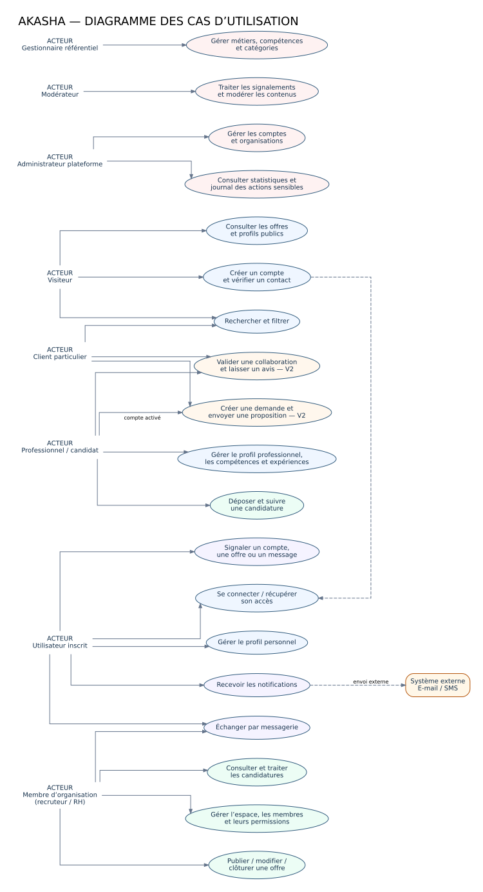
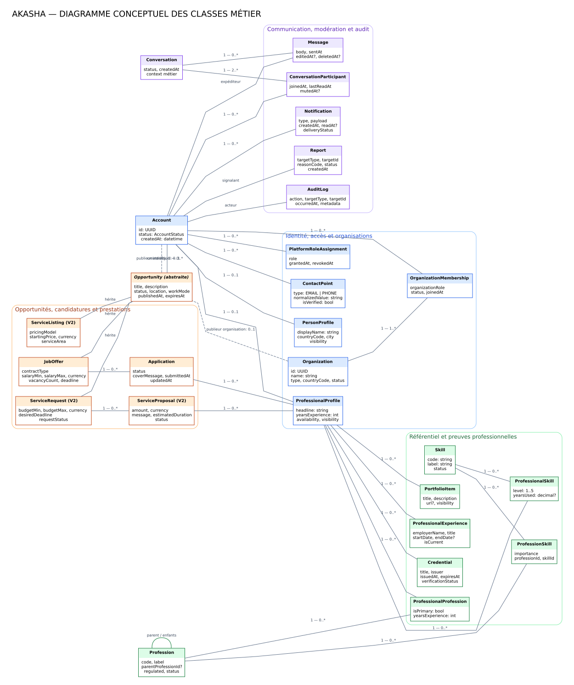

# AKASHA v1 — Étude conceptuelle, UML et règles de gestion

**Version du document :** 1.0  
**Périmètre :** modèle métier de la plateforme, avant conception détaillée et développement  
**Objectif :** disposer d'un modèle suffisamment précis pour créer la base de données, les services métier, les API et les interfaces sans prendre des décisions contradictoires au fil du code.

---

## 1. Décisions de conception à retenir

Akasha veut permettre à une même personne de rechercher un emploi, proposer des services, recruter, acheter une prestation et participer à la communauté. Le modèle ne doit donc **pas** imposer un type de compte exclusif.

Les décisions suivantes structurent l'ensemble du système :

1. **Un compte représente une identité, pas un métier.** Une personne ne crée pas un compte distinct lorsqu'elle devient freelance, candidate ou cliente.
2. **Les capacités sont cumulables.** Un compte peut avoir un profil professionnel, être membre de plusieurs organisations et agir comme client particulier.
3. **Une organisation est une entité distincte des comptes qui la gèrent.** Les employés accèdent à l'espace de l'organisation par une adhésion active assortie de permissions.
4. **Le référentiel des métiers est administrable.** Les métiers et compétences sont des données, non des conditions codées en dur dans l'application.
5. **Une opportunité a un type métier précis.** Une offre d'emploi, une demande de prestation et une offre de service partagent des informations communes mais n'ont pas les mêmes champs ni le même cycle de vie.
6. **Une candidature n'est pas une proposition commerciale.** La candidature répond à une offre d'emploi ; la proposition répond à une demande de prestation.
7. **Chaque action sensible est autorisée côté serveur.** Masquer un bouton dans l'interface ne constitue jamais une règle de sécurité.
8. **Les états métier sont contrôlés.** Le client ne choisit pas librement le statut d'une offre ou d'une candidature : il demande une action que le service métier valide.
9. **Le modèle global est plus large que le MVP.** Les objets de mise en relation de prestations sont prévus conceptuellement, mais le développement doit être activé par lots pour éviter de construire tous les modules avant de tester le marché.

### 1.1 Périmètre par version

| Version | Capacités incluses | Capacités à ne pas implémenter prématurément |
|---|---|---|
| **MVP / V1** | Comptes, contacts vérifiés, profils, organisations et adhésions, métiers/compétences, offres d'emploi et de mission, recherche, candidatures, espace recruteur, messagerie contextualisée, notifications, signalements et administration | Paiement intégré, portefeuille, séquestre, facturation automatique, litiges financiers, recommandations IA opaques |
| **V2** | Demandes de prestation, catalogue de services, propositions/devis, disponibilité, évaluations après collaboration vérifiée, outils de confiance plus poussés | Système financier complexe sans volume transactionnel validé |
| **V3** | Contrats, commandes, paiements, commissions, factures, remboursements et litiges, selon le pays et les prestataires de paiement disponibles | Détenir directement des fonds ou promettre un séquestre sans validation juridique et contractuelle |
| **V4+** | Plusieurs pays, langues, devises, règles professionnelles locales, analyse de marché et recommandations améliorées | Déployer simultanément toutes les législations et tous les métiers sans validation locale |

Le diagramme de classes représente le **modèle métier cible**, avec les entités V2 identifiées. Il ne signifie pas qu'il faut toutes les coder dans le premier sprint.

---

## 2. Frontière du système et vocabulaire

| Terme | Définition fonctionnelle |
|---|---|
| **Compte (`Account`)** | Identité authentifiée de la personne utilisant Akasha. Porte l'état du compte, les contacts et les habilitations de la plateforme. |
| **Profil personnel (`PersonProfile`)** | Informations générales de la personne et préférences de visibilité. |
| **Profil professionnel (`ProfessionalProfile`)** | Présentation de l'activité professionnelle : métiers, compétences, expérience, preuves, portfolio et disponibilité. Un compte peut l'activer sans renoncer à ses autres usages. |
| **Organisation (`Organization`)** | Entreprise, cabinet, association, établissement ou organisation publique qui agit sur la plateforme. |
| **Adhésion (`OrganizationMembership`)** | Lien entre un compte et une organisation, avec rôle, état et périmètre d'accès. |
| **Métier (`Profession`)** | Entrée du référentiel décrivant un métier ou une spécialité, éventuellement rattachée à un métier parent. |
| **Compétence (`Skill`)** | Capacité ou connaissance qui peut être associée à plusieurs métiers et profils. |
| **Opportunité (`Opportunity`)** | Élément publié, visible selon ses règles, qui décrit un besoin ou une offre professionnelle. C'est une classe conceptuelle abstraite. |
| **Offre d'emploi (`JobOffer`)** | Opportunité publiée par un employeur ou un recruteur pour pourvoir un poste, un stage ou un contrat de travail. |
| **Demande de prestation (`ServiceRequest`)** | Besoin formulé par un client qui attend des propositions de prestataires. Utilisée pour les missions freelance et prestations dans les versions ultérieures. |
| **Offre de service (`ServiceListing`)** | Présentation d'un service proposé par un professionnel. |
| **Candidature (`Application`)** | Réponse d'un candidat à une offre d'emploi. Elle conserve son propre statut et son historique. |
| **Proposition (`ServiceProposal`)** | Réponse d'un professionnel à une demande de prestation, pouvant contenir un prix, un délai et des conditions. |
| **Conversation (`Conversation`)** | Canal de discussion entre des participants autorisés, rattaché à un contexte métier. |
| **Signalement (`Report`)** | Demande de vérification d'un contenu, d'un compte ou d'une interaction. Ce n'est pas une sanction automatique. |
| **Rôle plateforme** | Permission interne d'administration, de modération, de gestion du référentiel ou de support. Il est distinct du rôle de recruteur dans une organisation. |

### 2.1 Acteurs, rôles et permissions : ne pas les confondre

- **Acteur** : personne ou système qui interagit avec Akasha.
- **Rôle fonctionnel** : manière dont un utilisateur utilise la plateforme, par exemple candidat, professionnel ou client.
- **Permission** : action précise autorisée dans un contexte donné, par exemple `application.read` sur les candidatures de sa propre organisation.
- **État** : indique si le compte, l'adhésion, l'offre ou la candidature peut actuellement participer au processus.

Un utilisateur peut donc être à la fois professionnel, client particulier et recruteur membre d'une organisation. À l'inverse, être membre d'une organisation ne donne pas automatiquement le droit de consulter toutes ses candidatures : la permission dépend du rôle organisationnel et de la politique d'accès.

---

## 3. Acteurs du système

| Acteur | Nature | Objectifs principaux | Droits essentiels | Limites à appliquer |
|---|---|---|---|---|
| **Visiteur** | Humain non authentifié | Découvrir la plateforme, consulter les offres publiques et profils visibles, rechercher | Lire les contenus publics ; démarrer une inscription | Ne peut pas candidater, publier, envoyer de message privé ni accéder aux données non publiques |
| **Utilisateur inscrit** | Humain authentifié | Gérer son compte, ses préférences et ses communications | Gérer les informations de son compte ; consulter les contenus accessibles ; signaler un abus | Aucun accès automatique aux données privées d'un autre compte |
| **Professionnel / candidat** | Rôle fonctionnel non exclusif | Créer son profil professionnel, ajouter compétences et expériences, rechercher des postes, déposer et suivre des candidatures | Gérer ses propres données professionnelles et candidatures ; proposer ses services lorsque le module est actif | Ne peut ni modifier le statut d'une candidature comme recruteur, ni déclarer une certification vérifiée lui-même |
| **Client particulier** | Rôle fonctionnel non exclusif | Trouver un professionnel, publier un besoin de prestation, contacter et comparer des prestataires | Rechercher ; publier et gérer ses propres demandes lorsque le module est actif | Ne peut pas publier au nom d'une entreprise sans adhésion et permission correspondantes |
| **Membre d'organisation** | Humain agissant au nom d'une organisation | Publier des offres, consulter des candidatures et gérer les recrutements | Actions limitées à l'organisation dont l'adhésion est active et aux permissions attribuées | Ne peut pas agir au nom d'une autre organisation ni conserver l'accès après révocation de son adhésion |
| **Propriétaire d'organisation (`OWNER`)** | Permission organisationnelle | Créer et administrer l'espace organisation | Gérer les membres, attribuer des rôles autorisés, transférer la propriété, gérer les paramètres de l'organisation | Ne peut pas supprimer l'historique d'audit ni contourner les règles globales de la plateforme |
| **Administrateur plateforme** | Rôle système privilégié | Configurer et superviser la plateforme | Actions d'administration explicitement accordées | Les actions sensibles doivent être limitées, journalisées et attribuées à un administrateur identifiable |
| **Modérateur** | Rôle plateforme spécialisé | Traiter les signalements, examiner les contenus et appliquer les mesures prévues | Examiner les dossiers, masquer/rejeter un contenu, suspendre temporairement selon la politique | Ne gère pas nécessairement les permissions système ni le référentiel métier |
| **Gestionnaire du référentiel** | Rôle plateforme spécialisé | Ajouter, corriger, traduire, fusionner ou désactiver métiers et compétences | Gérer le référentiel et son historique | Ne doit pas modifier les profils ou candidatures pour contourner les règles du métier |
| **Support** | Rôle plateforme spécialisé | Aider les utilisateurs, examiner les problèmes d'accès et d'usage | Accéder aux informations nécessaires au ticket selon une politique d'accès | Accès minimal, traçabilité et pas d'accès général aux pièces sensibles sans motif autorisé |
| **Service e-mail/SMS** | Système externe | Envoyer des codes de vérification et notifications | Reçoit uniquement les données nécessaires à l'envoi | Ne décide jamais des droits ni du statut métier d'un compte |
| **Prestataire de vérification** | Système ou opérateur externe, futur | Contribuer à la vérification de justificatifs, licences ou identités si nécessaire | Retourne un résultat de vérification et une référence | Le résultat doit être contrôlé et journalisé ; l'intégration dépend du métier et du pays |
| **Prestataire de paiement** | Système externe, V3 | Traiter les paiements et remboursements | Fournit identifiants, états et preuves de transaction | Akasha ne doit pas considérer une simple redirection du navigateur comme une preuve de paiement réussi |

### 3.1 Matrice de droits minimale

| Action | Visiteur | Utilisateur | Professionnel | Membre RH | Owner organisation | Modérateur | Gestionnaire référentiel |
|---|---:|---:|---:|---:|---:|---:|---:|
| Consulter une offre publiée | Oui | Oui | Oui | Oui | Oui | Oui | Oui |
| Modifier son profil personnel | Non | Oui | Oui | Oui | Oui | Oui | Oui |
| Gérer son profil professionnel | Non | Si activé | Oui | Oui, si son compte a ce profil | Oui, si son compte a ce profil | Oui, si son compte a ce profil | Oui, si son compte a ce profil |
| Déposer une candidature | Non | Si profil professionnel requis | Oui | Oui, à titre personnel | Oui, à titre personnel | Oui, à titre personnel | Oui, à titre personnel |
| Publier une offre au nom d'une organisation | Non | Non par défaut | Non par défaut | Si permission `opportunity.create` | Oui selon la politique de l'organisation | Non, sauf rôle métier distinct |
| Consulter les candidatures d'une organisation | Non | Non | Non | Si permission `application.read` | Oui | Non, sauf dossier de modération autorisé |
| Changer le statut d'une candidature | Non | Non | Non | Si permission `application.manage` | Oui | Non |
| Gérer les adhésions de l'organisation | Non | Non | Non | Seulement si permission spécifique | Oui | Non |
| Traiter un signalement | Non | Non | Non | Non | Non par défaut | Oui | Non |
| Modifier le référentiel des métiers | Non | Non | Non | Non | Non | Non par défaut | Oui |

Cette matrice est le point de départ. Les permissions sont vérifiées côté serveur à chaque endpoint et service métier, avec le contexte de l'objet demandé.

---

## 4. Diagramme UML des cas d'utilisation

Le diagramme ci-dessous montre les grandes interactions entre les acteurs et le système. Les fonctionnalités de demande de prestation et d'avis sont marquées comme V2. Le diagramme n'est pas un ordre de développement.



**Source modifiable :** [`diagrammes/cas_utilisation.puml`](diagrammes/cas_utilisation.puml)

### 4.1 Cas d'utilisation couverts

| Domaine | Cas d'utilisation principaux |
|---|---|
| Découverte | Consulter les offres et profils publics ; rechercher et filtrer ; consulter le détail d'une offre |
| Identité | Créer un compte ; vérifier un contact ; se connecter ; récupérer un accès ; gérer son profil personnel |
| Professionnel | Créer/mettre à jour son profil professionnel ; gérer métiers, compétences, expérience, justificatifs et portfolio |
| Emploi | Rechercher une offre ; déposer une candidature ; consulter l'historique ; retirer une candidature selon son statut |
| Organisation | Créer un espace ; inviter/retirer un membre ; attribuer des rôles ; publier, modifier, mettre en pause ou clôturer une offre |
| Recrutement | Lire les candidatures autorisées ; présélectionner ; planifier une étape ; modifier le statut ; communiquer avec un candidat |
| Communication | Ouvrir une conversation autorisée ; envoyer un message ; recevoir des notifications ; signaler un abus |
| Administration | Gérer comptes et organisations ; traiter les signalements ; administrer métiers et compétences ; lire les journaux et statistiques autorisés |
| Prestations — V2 | Déposer une demande ; recevoir et examiner des propositions ; comparer les devis ; accepter une proposition ; laisser un avis après collaboration vérifiée |

### 4.2 Règles de lecture du diagramme

- L'authentification est requise pour toute action qui modifie des données ou expose des données privées.
- `Membre d'organisation` signifie un compte avec une adhésion active, et non une personne ayant simplement saisi le nom d'une entreprise.
- Les spécialisations d'acteurs ne sont pas exclusives dans la réalité : une même personne peut remplir plusieurs rôles.
- Le diagramme représente les objectifs visibles de l'acteur. Les contrôles anti-abus, les règles de validation et les transitions d'état sont définis dans les règles de gestion ci-dessous.

---

## 5. Diagramme conceptuel de classes

Le diagramme décrit les objets métier et leurs relations majeures. Les types `UUID`, `datetime`, `decimal` et les énumérations sont des indications conceptuelles ; les types SQL définitifs seront fixés pendant la conception logique de la base de données.



**Source modifiable :** [`diagrammes/classes_domaine.puml`](diagrammes/classes_domaine.puml)

### 5.1 Entités principales et responsabilités

| Entité | Responsabilité | Contraintes structurantes |
|---|---|---|
| `Account` | Identité et état d'accès | Unique ; un compte ne correspond pas à un métier ; un compte suspendu ne peut effectuer aucune action métier interdite |
| `ContactPoint` | E-mail ou téléphone utilisable pour la connexion et les notifications | Valeur normalisée ; unicité selon la politique retenue ; preuve de vérification ; contact principal unique par type si nécessaire |
| `PersonProfile` | Identité visible et informations personnelles | Au plus un par compte ; visibilité configurable ; données privées séparées des données publiques |
| `ProfessionalProfile` | Présentation professionnelle | Au plus un en V1 par compte ; plusieurs métiers, expériences, compétences et preuves possibles |
| `Organization` | Espace entreprise/structure | Cycle de vie propre ; les actions se font par ses membres autorisés |
| `OrganizationMembership` | Relation compte-organisation et rôle dans celle-ci | Unicité du couple compte/organisation ; statut actif requis pour agir ; historique de révocation conservé |
| `PlatformRoleAssignment` | Rôle d'administration dans Akasha | Séparé des rôles de l'organisation ; attribution/révocation journalisée |
| `Profession` | Arbre extensible des métiers et spécialités | Identifiant stable ; parent facultatif ; pas de cycle ; désactivation plutôt que suppression si utilisée |
| `Skill` | Compétence réutilisable | Identifiant stable ; peut être reliée à plusieurs métiers |
| `ProfessionalProfession` | Métier déclaré par un professionnel | Une seule spécialité principale au maximum ; relation plusieurs-à-plusieurs entre profil et métiers |
| `ProfessionSkill` | Association compétence-métier | Relation plusieurs-à-plusieurs ; importance éventuelle : requise, recommandée ou facultative |
| `ProfessionalSkill` | Niveau déclaré d'une compétence | Une association par profil et compétence ; niveau dans l'échelle configurée ; déclaration distincte de la vérification |
| `ProfessionalExperience` | Historique professionnel | Dates cohérentes ; une expérience actuelle n'a pas de date de fin |
| `Credential` | Certification, licence, diplôme ou justificatif déclaré | État de vérification indépendant de la déclaration de l'utilisateur ; expiration et pays/émetteur conservés si disponibles |
| `PortfolioItem` | Réalisation, projet ou lien professionnel | Propriétaire unique ; contrôle de visibilité et de sécurité des pièces jointes |
| `Opportunity` | Champs communs aux annonces | Classe abstraite ; publieur unique ; statut contrôlé ; historique conservé |
| `JobOffer` | Offre d'emploi, stage ou contrat de travail | Contrat, salaire, échéance et nombre de postes adaptés au type d'offre |
| `ServiceRequest` | Besoin d'un client en prestations | Budget, date souhaitée et état de demande ; fonctionnalité complète en V2 |
| `ServiceListing` | Offre de service d'un professionnel | Mode de tarification et zone desservie ; fonctionnalité complète en V2 |
| `Application` | Candidature à une offre d'emploi | Unique par offre et compte candidat selon la politique V1 ; statut et dates propres ; candidature associée à une preuve de ce qui a été soumis |
| `ServiceProposal` | Proposition d'un professionnel en réponse à une demande | Reliée à une demande et à un profil professionnel ; prix, devise, délai et état ; V2 |
| `Conversation` | Contexte d'échange | Participants autorisés ; liée à une candidature ou opportunité en V1 |
| `ConversationParticipant` | Appartenance d'un compte à une conversation | Un compte ne reçoit que les messages des conversations auxquelles il participe |
| `Message` | Message envoyé dans une conversation | Auteur authentifié et participant ; contrôle anti-spam ; horodatage et éventuelle preuve de modération |
| `Notification` | Événement destiné à un compte | Le destinataire ne peut lire que ses notifications ; l'échec d'envoi externe ne doit pas annuler une action métier réussie |
| `Report` | Signalement | Cible, motif, statut, dates et résultat de modération ; signaler ne suspend pas automatiquement la cible |
| `AuditLog` | Traçabilité des actions sensibles | Non modifiable par les utilisateurs ordinaires ; acteur, cible, date et résultat conservés selon une politique de rétention |

### 5.2 Relations métier essentielles

1. Un compte peut avoir un profil personnel et zéro ou un profil professionnel.
2. Un profil professionnel peut présenter plusieurs métiers, compétences, expériences, justificatifs et réalisations.
3. Un métier peut être parent de plusieurs métiers et être associé à plusieurs compétences ; une compétence peut être associée à plusieurs métiers.
4. Une organisation possède plusieurs adhésions et doit conserver au moins un propriétaire actif.
5. Une opportunité est créée par un compte, mais peut être publiée à titre individuel ou au nom d'une organisation. **Une seule de ces deux cibles de publication doit être renseignée.**
6. Une offre d'emploi reçoit des candidatures ; une demande de prestation reçoit des propositions. Ce sont deux agrégats métier distincts.
7. Une conversation possède deux participants ou plus dans le modèle général. Les permissions de lecture et d'envoi dépendent du contexte de la conversation et du statut des participants.
8. Un signalement et une action de modération doivent conserver l'historique. Une action administrative ne doit pas réécrire silencieusement les données historiques.

### 5.3 Décisions de modèle à ne pas laisser ambiguës

**Un compte ou un profil ?** Le compte porte la connexion et les droits ; le profil porte les données descriptives. Ne pas mélanger mot de passe, informations publiques, CV et paramètres de visibilité dans une seule table.

**Métier ou compétence ?** Un métier est une catégorie professionnelle ; une compétence est une capacité. Un développeur peut déclarer Python, SQL et sécurité, et un même métier peut recommander de nombreuses compétences.

**Employeur ou recruteur ?** L'employeur est l'organisation qui publie ou porte l'offre. Le recruteur est un compte membre de cette organisation, agissant selon une permission. Le compte qui crée l'annonce reste enregistré séparément du publieur.

**Offre ou candidature ?** Une offre appartient à l'émetteur ; une candidature appartient au candidat et référence l'offre. Les deux entités ont des statuts différents.

**Déclaré ou vérifié ?** Une qualification renseignée par un utilisateur n'est pas automatiquement validée par Akasha. Le statut de vérification doit être explicite.

**Suppression ou archivage ?** Les données nécessaires à l'historique, aux signalements, aux candidatures ou aux obligations applicables ne doivent pas être supprimées en cascade sans politique définie. Pour les annonces et entrées de référentiel, privilégier la clôture ou la désactivation lorsque des enregistrements les référencent.

---

## 6. Règles de gestion détaillées

Les règles ci-dessous sont les invariants à transformer ensuite en validations de schéma, contraintes de base de données, politiques d'autorisation et tests métier. Les règles marquées **V2** ou **V3** doivent être documentées dès maintenant mais ne sont pas toutes à coder dans la V1.

### A. Identité, inscription et sécurité du compte

**RG-ACC-01 — Identité unique.** Un compte correspond à une personne et possède un identifiant interne immuable. La personne ne doit pas créer un nouveau compte simplement pour cumuler les fonctions de candidat, professionnel et client.

**RG-ACC-02 — Contact vérifié.** Pour activer les fonctions authentifiées, le compte doit posséder au moins un moyen de contact vérifié, selon les canaux activés par Akasha. Le compte peut compléter ses autres coordonnées plus tard.

**RG-ACC-03 — Normalisation.** Avant comparaison ou unicité, les e-mails sont normalisés (espaces retirés, casse gérée selon une politique uniforme) et les téléphones sont enregistrés sous une forme normalisée incluant l'indicatif pays lorsque possible. Ne jamais appliquer une règle de comparaison différente dans l'inscription et la connexion.

**RG-ACC-04 — Unicité du contact.** Un contact vérifié ne peut être rattaché simultanément à plusieurs comptes, sauf mécanisme explicitement conçu et sécurisé pour les organisations ou les comptes partagés. Les comptes partagés ne doivent pas être le modèle par défaut.

**RG-ACC-05 — Vérification à usage limité.** Un code de vérification est à usage unique, expire, possède une limite d'essais et ne doit pas être stocké en clair de manière récupérable. Un code expiré ou déjà utilisé est refusé.

**RG-ACC-06 — Mot de passe.** Si l'authentification par mot de passe est activée, seul un hachage robuste et adapté est conservé ; le mot de passe en clair ne doit jamais être journalisé ni envoyé par notification.

**RG-ACC-07 — Réinitialisation sécurisée.** Un jeton de réinitialisation expire, ne s'utilise qu'une fois et invalide les précédents selon la politique de sécurité. Le message de réponse ne doit pas révéler si une adresse existe ou non dans la base.

**RG-ACC-08 — États du compte.** États proposés : `PENDING_VERIFICATION`, `ACTIVE`, `SUSPENDED`, `CLOSED`. Un compte suspendu ne peut ni publier, ni candidater, ni envoyer de message, ni utiliser une API métier protégée. Les lectures publiques autorisées et l'accès à une procédure de recours sont définis séparément.

**RG-ACC-09 — Protection contre les essais abusifs.** Les tentatives de connexion, de vérification, de récupération et d'envoi de messages sont limitées par compte, adresse réseau et/ou autres signaux de risque, sans se reposer sur un seul identifiant facilement modifiable.

**RG-ACC-10 — Consentements.** L'acceptation des conditions et de la politique de confidentialité doit enregistrer la version et la date. Les consentements marketing, lorsqu'ils existent, restent distincts des communications nécessaires au service.

**RG-ACC-11 — Clôture.** La fermeture d'un compte retire l'accès et masque les données publiques selon la politique définie. Les enregistrements nécessaires à la sécurité, à la prévention des abus, aux litiges ou aux obligations applicables suivent une politique de rétention spécifique ; ils ne sont pas supprimés aveuglément par cascade.

**RG-ACC-12 — Identifiant d'autorisation.** Le serveur déduit l'identité de l'utilisateur à partir de la session ou du jeton validé. Il ne doit jamais accepter un `account_id` envoyé par le client comme preuve que l'appelant possède ce compte.

### B. Rôles, organisations et permissions

**RG-ORG-01 — Organisation distincte.** Une organisation possède son propre identifiant, statut et profil. Plusieurs comptes peuvent agir pour elle sans partager leurs identifiants de connexion.

**RG-ORG-02 — Propriétaire initial.** À la création, l'organisation doit avoir au moins un propriétaire (`OWNER`) actif. La création de l'espace et l'adhésion du premier propriétaire doivent être atomiques : il ne doit pas exister d'organisation orpheline.

**RG-ORG-03 — Unicité d'adhésion.** Un compte ne peut avoir qu'une adhésion logique active par organisation. Si l'utilisateur est retiré puis réinvité, l'historique de l'ancienne adhésion est conservé ou réactivé selon une règle explicite.

**RG-ORG-04 — Permission contextuelle.** Toute action au nom d'une organisation vérifie simultanément : compte actif, adhésion active, rôle suffisant, permission sur l'action et appartenance de la ressource à cette organisation.

**RG-ORG-05 — Principe du moindre privilège.** Un recruteur ne peut obtenir automatiquement les droits d'administration des membres ni les droits de propriétaire. Les permissions de publication, lecture des candidatures, gestion des statuts et gestion des membres sont séparables.

**RG-ORG-06 — Révocation immédiate.** Après révocation ou suspension d'une adhésion, les nouveaux appels sont refusés sans attendre la fin d'une session longue. Les accès déjà ouverts à des pages privées ne doivent pas permettre une nouvelle lecture via API.

**RG-ORG-07 — Transfert de propriété.** Une propriété ne peut être transférée qu'à un compte actif habilité, avec confirmation et journalisation. L'opération ne doit jamais laisser l'organisation sans propriétaire actif.

**RG-ORG-08 — Statut organisationnel.** Une organisation peut être `PENDING`, `ACTIVE`, `SUSPENDED` ou `CLOSED`. Une organisation suspendue ne peut publier de nouvelles annonces ni modifier ses annonces pour contourner la suspension.

**RG-ORG-09 — Pas de confiance sur le nom saisi.** Affirmer dans un champ libre que l'on représente une entreprise ne donne aucun droit sur son espace. L'accès vient d'une adhésion vérifiable.

**RG-ORG-10 — Traçabilité.** Les publications, changements de statut, ajouts/retraits de membres et modifications de permissions doivent identifier le compte auteur et l'organisation concernée.

### C. Profils personnels et professionnels

**RG-PRO-01 — Séparation des données.** Le profil public ne révèle pas par défaut le mot de passe, les contacts privés, les pièces d'identité, les notes internes du recruteur ni les informations privées de compte.

**RG-PRO-02 — Profil professionnel facultatif.** Un compte peut exister sans profil professionnel. Certaines actions, notamment candidater ou proposer une prestation, exigent un profil professionnel actif et suffisamment complété.

**RG-PRO-03 — Un profil en V1.** En V1, un compte possède au maximum un profil professionnel, mais ce profil accepte plusieurs métiers, spécialités, compétences et expériences. La capacité à gérer plusieurs portfolios spécialisés pourra être ajoutée si une demande réelle la justifie.

**RG-PRO-04 — Visibilité.** Le propriétaire choisit les éléments de profil rendus publics lorsque la fonction de confidentialité est disponible. L'existence d'une candidature ne rend pas automatiquement l'ensemble du profil visible à tous les employeurs.

**RG-PRO-05 — Cohérence des dates.** Une expérience professionnelle ne peut avoir une date de fin antérieure à sa date de début. Une expérience marquée « en cours » ne doit pas avoir de date de fin.

**RG-PRO-06 — Échelle des compétences.** Le niveau d'une compétence utilise une échelle commune et documentée (par exemple 1 à 5). Le score déclaré est une déclaration de l'utilisateur, pas une certification vérifiée.

**RG-PRO-07 — Qualifications déclarées.** Une personne peut déclarer un diplôme ou une certification, mais ne peut pas attribuer elle-même l'état `VERIFIED`. Seul un processus de vérification autorisé peut le faire.

**RG-PRO-08 — Expiration des preuves.** Lorsqu'un justificatif possède une date d'expiration, le système doit pouvoir signaler qu'il est expiré et ne plus l'afficher comme preuve actuellement valide.

**RG-PRO-09 — Pièces jointes privées.** Les CV, diplômes et justificatifs sont stockés dans un espace non public. Leur téléchargement exige une autorisation sur la ressource ; une URL devinable ou permanente n'est pas suffisante comme contrôle.

**RG-PRO-10 — Portfolio.** Un élément de portfolio doit être contrôlé comme contenu utilisateur : droits d'accès, type et taille des fichiers, liens dangereux, signalement et suppression/masquage par le propriétaire ou la modération selon la politique.

**RG-PRO-11 — Exactitude et contestation.** Un utilisateur peut corriger ses données. Si une donnée a déjà été intégrée à une candidature ou à une décision, l'historique de ce qui a été soumis doit rester consultable selon les droits autorisés.

### D. Référentiel métiers et compétences

**RG-TAX-01 — Référentiel configurable.** Les métiers, spécialités, catégories et compétences sont stockés comme données administrables. L'ajout d'un métier courant ne doit pas nécessiter une nouvelle version du code.

**RG-TAX-02 — Hiérarchie sans cycle.** Un métier ne peut pas être son propre parent, directement ou indirectement. La création ou le déplacement d'un métier doit vérifier l'absence de cycle.

**RG-TAX-03 — Codes stables.** Chaque métier et compétence possède un identifiant stable indépendant de son libellé. Modifier un libellé ne doit pas casser les candidatures, profils ou recherches historiques.

**RG-TAX-04 — Doublons contrôlés.** Le système détecte les doublons probables selon parent, langue, pays ou synonymes. Une fusion doit rediriger les références et conserver une trace plutôt que supprimer silencieusement l'ancienne entrée.

**RG-TAX-05 — Désactivation.** Un métier ou une compétence déjà utilisée est désactivé plutôt que supprimé physiquement. Les anciennes annonces continuent d'afficher un libellé compréhensible.

**RG-TAX-06 — Plusieurs métiers par profil.** Un profil peut être associé à plusieurs métiers. Une règle permet de déclarer un métier principal au maximum si l'interface a besoin d'un métier principal.

**RG-TAX-07 — Compétences partagées.** Une compétence peut être liée à plusieurs métiers et un métier peut être associé à plusieurs compétences. Ces associations ne doivent pas être dupliquées.

**RG-TAX-08 — Règles nationales.** Les métiers réglementés sont associés à des règles de vérification par pays. Le simple fait d'être référencé comme professionnel ne vaut pas autorisation légale d'exercer.

**RG-TAX-09 — Libellés multilingues.** Les codes métier ne changent pas lorsqu'un libellé est traduit. Une langue de référence et une stratégie de libellés absents doivent être définies.

**RG-TAX-10 — Historique.** Les modifications du référentiel doivent enregistrer l'auteur, la date, la nature du changement et, lorsque nécessaire, les anciennes valeurs.

### E. Offres d'emploi, missions et annonces

**RG-OFF-01 — Publieur unique.** Une opportunité est créée par un compte actif et publiée soit à titre individuel, soit au nom d'une organisation. Une opportunité ne peut pas avoir les deux publieurs en même temps ni aucun publieur.

**RG-OFF-02 — Autorisation de publication.** Pour publier au nom d'une organisation, le créateur doit avoir une adhésion active et la permission `opportunity.create` ou `opportunity.manage`. Pour publier à titre individuel, il doit être autorisé à utiliser cette fonctionnalité et ne pas être suspendu.

**RG-OFF-03 — Champs selon le type.** Les champs obligatoires dépendent du sous-type : une offre d'emploi exige les informations nécessaires au poste et au processus de candidature ; une demande de prestation exige le besoin, l'échéance et les modalités de réponse ; une offre de service précise la prestation proposée.

**RG-OFF-04 — Types de contrats.** `CDI`, `CDD`, stage, apprentissage, temporaire et autres types contrôlés sont des valeurs de référence. Ne pas enregistrer des variantes libres qui empêchent de filtrer les résultats.

**RG-OFF-05 — Fourchette financière.** Lorsqu'un montant minimum et maximum est renseigné, ils doivent être positifs ou nuls selon la règle choisie et le minimum doit être inférieur ou égal au maximum. La devise est obligatoire lorsque le montant est renseigné.

**RG-OFF-06 — Dates.** Une date limite de candidature ou une échéance ne doit pas précéder la publication. À l'expiration, l'offre devient automatiquement non recevable pour de nouvelles candidatures ou réponses, sauf prolongation explicite autorisée.

**RG-OFF-07 — Mode de travail.** Une offre `ONSITE` doit préciser une localisation suffisamment exploitable ; `REMOTE` peut préciser les pays ou fuseaux acceptés ; `HYBRID` indique au minimum une zone ou des modalités de présence.

**RG-OFF-08 — Cycle de vie.** États recommandés : `DRAFT`, `PENDING_REVIEW`, `PUBLISHED`, `PAUSED`, `FILLED`, `EXPIRED`, `REJECTED`, `ARCHIVED`. Seules les transitions autorisées par le service métier sont acceptées.

**RG-OFF-09 — Publication.** Une annonce ne passe à `PUBLISHED` que si tous les champs requis sont valides, le publieur est autorisé, le compte/l'organisation est actif et les contrôles de modération requis sont satisfaits.

**RG-OFF-10 — Pause et clôture.** Une offre en pause, remplie, expirée, rejetée ou archivée n'accepte pas de nouvelle candidature. Les candidatures existantes restent accessibles aux acteurs autorisés selon leur historique.

**RG-OFF-11 — Capacité restante.** Si le nombre de postes est atteint ou si l'employeur clôture le recrutement, le système refuse les nouvelles candidatures. La décision doit être cohérente en cas de candidatures simultanées.

**RG-OFF-12 — Modification après publication.** Les changements majeurs (rémunération, contrat, responsabilités, lieu, date limite) peuvent déclencher une nouvelle validation ou notification aux candidats. L'historique des versions pertinentes doit être conservé.

**RG-OFF-13 — Retrait par l'émetteur.** Seul le publieur ou un utilisateur autorisé de son organisation peut suspendre, clôturer ou archiver l'annonce. Le retrait ne doit pas effacer les candidatures ni l'historique.

**RG-OFF-14 — Modération et signalement.** Le signalement d'une offre ouvre un dossier ; il n'entraîne pas automatiquement le rejet. Un modérateur peut masquer temporairement le contenu si la politique de risque le permet, avec trace de la décision.

**RG-OFF-15 — Recherche publique.** Seules les annonces publiées et encore recevables apparaissent dans les résultats publics par défaut. Les annonces privées, rejetées ou suspendues sont exclues, sauf vue administrative autorisée.

**RG-OFF-16 — Aucun contenu trompeur.** Les champs de salaire, certification, localisation et identité de l'employeur ne doivent pas être présentés comme vérifiés lorsqu'ils ne le sont pas. Un badge de vérification doit avoir une définition et une preuve traçable.

### F. Candidatures et processus de recrutement

**RG-APP-01 — Conditions de dépôt.** Pour déposer une candidature, le compte doit être actif, l'offre publiée et ouverte, l'échéance non dépassée et le profil professionnel requis disponible.

**RG-APP-02 — Une candidature par candidat et offre.** En V1, la combinaison offre + compte candidat est unique. Les répétitions réseau ou clics multiples doivent retourner la candidature existante ou un résultat idempotent, pas créer des doublons.

**RG-APP-03 — Pas de candidature à soi-même.** Un compte ne peut pas candidater à une offre qu'il a publiée à titre individuel. Un membre d'organisation ne peut pas candidater à une offre publiée au nom de cette organisation via le même compte, sauf exception métier expressément autorisée.

**RG-APP-04 — Périmètre organisationnel.** Seuls les membres autorisés de l'organisation publieuse peuvent consulter ou traiter les candidatures. Une organisation ne peut pas lire les candidatures de ses concurrentes en modifiant un identifiant dans l'URL.

**RG-APP-05 — Statuts contrôlés.** États proposés : `SUBMITTED`, `REVIEWING`, `SHORTLISTED`, `INTERVIEW`, `OFFERED`, `ACCEPTED`, `REJECTED`, `WITHDRAWN`. Les transitions sont définies dans une table de transitions côté serveur.

**RG-APP-06 — Autorité sur les statuts.** Le candidat peut soumettre ou retirer sa candidature dans les conditions prévues. Le recruteur autorisé gère les étapes de sélection. Le candidat ne peut jamais s'attribuer lui-même le statut `SHORTLISTED`, `OFFERED` ou `ACCEPTED`.

**RG-APP-07 — Retrait.** Le candidat peut retirer sa candidature tant que le processus et le statut le permettent. Après retrait, la candidature est conservée comme `WITHDRAWN` pour l'historique et la prévention des duplications.

**RG-APP-08 — Historique.** Chaque changement de statut conserve l'ancien statut, le nouveau statut, l'auteur, l'heure et, si nécessaire, une raison. Les changements sensibles ne sont pas écrasés par la simple mise à jour d'une colonne.

**RG-APP-09 — Preuve de soumission.** Le système conserve un instantané minimal des informations soumises (version de CV utilisée, message de motivation et champs significatifs) pour que les mises à jour ultérieures du profil ne réécrivent pas rétroactivement la candidature.

**RG-APP-10 — Notifications.** Une candidature reçue notifie les recruteurs autorisés ; un changement important notifie le candidat. L'échec d'un SMS ou e-mail ne doit pas annuler la candidature ni effacer l'événement métier.

**RG-APP-11 — Confidentialité.** Les autres candidats ne peuvent pas voir une candidature, les notes internes ou les décisions du recruteur. Les commentaires internes et les messages destinés au candidat doivent être séparés.

**RG-APP-12 — Équité des traitements.** Les critères de tri et présélection doivent être présentés comme des aides au recrutement. Une recommandation automatique ne doit pas se transformer silencieusement en rejet définitif sans règle et contrôle humain appropriés.

**RG-APP-13 — Suppression.** Une candidature liée à un recrutement ou un signalement ne doit pas être supprimée sans prendre en compte l'historique, les demandes de l'utilisateur et les obligations applicables. Préférer un état de retrait ou une anonymisation contrôlée lorsque nécessaire.

### G. Demandes de prestations, offres de services et propositions — V2

**RG-SVC-01 — Propriétaire de la demande.** Une demande appartient au compte client qui l'a créée ou est publiée au nom d'une organisation autorisée. Le créateur et le publieur sont identifiés séparément.

**RG-SVC-02 — Besoin exploitable.** Une demande publiée précise au minimum une description, une catégorie ou compétence utile, les modalités de réalisation et les informations de budget/délai disponibles. Le formulaire peut permettre « budget à discuter » plutôt qu'un faux montant obligatoire.

**RG-SVC-03 — Proposition d'un professionnel.** Un professionnel ne peut proposer ses services que si son compte et son profil sont actifs et si la demande est ouverte aux propositions.

**RG-SVC-04 — Une proposition contrôlée.** Une proposition contient un message, une estimation financière si applicable, une devise, un délai et une durée de validité lorsque ce sont des éléments de négociation. Les montants doivent être validés côté serveur.

**RG-SVC-05 — Éviter les propositions dupliquées.** Une même combinaison demande + professionnel ne doit pas produire plusieurs propositions actives simultanées. Une mise à jour de la proposition conserve l'historique pertinent.

**RG-SVC-06 — Cycle de demande.** États proposés : `OPEN`, `IN_DISCUSSION`, `AWARDED`, `CANCELLED`, `EXPIRED`. Une demande `AWARDED`, `CANCELLED` ou `EXPIRED` n'accepte plus de nouvelles propositions.

**RG-SVC-07 — Acceptation explicite.** L'acceptation d'une proposition doit être enregistrée comme une action explicite du client autorisé. Elle ne constitue pas la preuve d'un paiement effectué.

**RG-SVC-08 — Conditions contractuelles.** Le périmètre, le prix, les livrables, l'échéance et les conditions de modification doivent être confirmés avant de gérer une prestation comme une collaboration engagée.

**RG-SVC-09 — Pas de notation sans interaction réelle.** Un avis n'est autorisé que lorsque la plateforme peut relier les deux parties à une collaboration répondant aux conditions de validation définies.

### H. Messagerie et notifications

**RG-MSG-01 — Participation obligatoire.** Seul un compte appartenant à une conversation peut consulter ses messages, envoyer un message ou connaître les métadonnées privées de cette conversation.

**RG-MSG-02 — Autorisation contextuelle.** En V1, la conversation doit être reliée à une candidature ou une opportunité autorisée. Le système vérifie que chaque participant a le droit de consulter ce contexte et que la conversation n'est pas interdite par un blocage ou une suspension.

**RG-MSG-03 — Révocation des droits.** Si l'adhésion d'un recruteur est révoquée, son accès aux conversations et candidatures privées de l'organisation est recalculé immédiatement. Son historique comme auteur reste traçable.

**RG-MSG-04 — Anti-spam.** Le système limite la fréquence, la taille, les répétitions et certains comportements anormaux. Le blocage et le signalement doivent être possibles conformément à la politique de la plateforme.

**RG-MSG-05 — Fichiers.** Les pièces jointes sont limitées par taille, type autorisé et contrôle de sécurité. Elles ne doivent pas être accessibles via un chemin public prévisible.

**RG-MSG-06 — Intégrité des messages.** Un message a un auteur, une conversation et un horodatage serveur. Une modification ou suppression, si autorisée, laisse une trace adaptée lorsqu'une enquête ou un signalement l'exige.

**RG-MSG-07 — Notifications internes d'abord.** L'événement métier et sa notification interne sont persistés indépendamment de l'envoi externe. Une panne d'e-mail/SMS provoque une nouvelle tentative ou un état d'échec, pas la perte de la candidature ou du message.

**RG-MSG-08 — Confidentialité des notifications.** Le contenu d'un e-mail/SMS doit éviter de divulguer des informations sensibles sur un appareil partagé. Il peut inviter l'utilisateur à ouvrir Akasha pour voir le détail authentifié.

**RG-MSG-09 — Préférences.** Les notifications obligatoires au fonctionnement du compte sont séparées des notifications facultatives et du marketing. Le canal préféré ne doit pas contourner un consentement requis.

### I. Réputation, vérification et confiance — V2

**RG-TRU-01 — Avis fondé sur une interaction.** Un avis n'est publiable que par un participant à une collaboration validée, dans la fenêtre temporelle et les conditions fixées par la politique de notation.

**RG-TRU-02 — Une évaluation par partie.** Une même partie ne peut pas publier des avis multiples pour gonfler artificiellement la note d'une même collaboration. Une correction suit un processus de modification tracé.

**RG-TRU-03 — Droit de réponse et contestation.** La personne évaluée peut signaler un avis, fournir une réponse si la fonction est disponible et demander une modération ; le fait de contester ne supprime pas automatiquement l'avis.

**RG-TRU-04 — Pas de suppression contre paiement.** Les avis négatifs ne peuvent pas être supprimés parce qu'un utilisateur achète un abonnement ou une visibilité premium. La modération applique les mêmes critères.

**RG-TRU-05 — Badges explicites.** Chaque badge précise ce qui a été vérifié, par qui, à quelle date et jusqu'à quelle échéance éventuelle. « Compte vérifié », « identité vérifiée », « certification vérifiée » et « entreprise vérifiée » ne sont pas synonymes.

**RG-TRU-06 — Vérification des métiers réglementés.** La disponibilité des fonctionnalités liées à une profession réglementée dépend des règles du pays et de la preuve requise. Une vérification expirée doit être signalée et ne plus être affichée comme valide.

### J. Recherche, filtres et recommandations

**RG-SRC-01 — Filtrage selon la visibilité.** La recherche ne renvoie que les annonces et profils que l'utilisateur est autorisé à voir. Les statuts non publics sont exclus par défaut.

**RG-SRC-02 — Filtres cohérents.** Les filtres de type de contrat, lieu, travail à distance, salaire/budget, compétence, métier et disponibilité utilisent des valeurs normalisées quand cela est possible.

**RG-SRC-03 — Salaire inconnu.** Une annonce sans salaire ne doit pas être interprétée comme une rémunération égale à zéro. Les résultats doivent distinguer « non renseigné » de « aucun montant ».

**RG-SRC-04 — Fuseaux et dates.** Les dates sont stockées avec une référence temporelle cohérente et affichées dans le fuseau approprié. Une échéance ne doit pas se fermer trop tôt à cause du fuseau du téléphone.

**RG-SRC-05 — Recommandations explicables.** Un score de correspondance peut combiner métier, compétences, expérience, localisation, disponibilité et préférences. Le score ne doit pas être présenté comme une garantie de compétence ni de recrutement.

**RG-SRC-06 — Pas d'autorisation par pertinence.** Le fait qu'un profil corresponde fortement à une offre n'autorise pas l'accès à ses coordonnées privées ou à ses justificatifs.

**RG-SRC-07 — Résultats vides.** Si aucun résultat ne correspond, le système retourne une liste vide explicite, permet d'assouplir les filtres et ne fabrique pas de résultats fictifs.

### K. Modération, signalements et administration

**RG-ADM-01 — Motif obligatoire.** Un signalement doit contenir une cible valide et un motif structuré. Un commentaire complémentaire peut être facultatif.

**RG-ADM-02 — Le signalement n'est pas un verdict.** Le dossier prend un état tel que `OPEN`, `UNDER_REVIEW`, `ACTIONED` ou `DISMISSED`. Une décision de sanction nécessite une action autorisée et une raison adaptée.

**RG-ADM-03 — Accès de modération limité.** Le modérateur ne voit que les données nécessaires pour instruire un dossier. Les documents sensibles ne sont consultés que si le traitement l'exige et que la permission le permet.

**RG-ADM-04 — Journalisation.** Toute suspension, restauration, suppression administrative, validation de justificatif, modification de rôle ou intervention sur un contenu sensible génère un événement d'audit avec acteur, date, cible, motif et résultat.

**RG-ADM-05 — Immutabilité opérationnelle.** Un administrateur ne peut pas modifier ni effacer discrètement ses propres traces d'audit depuis l'interface normale. Les accès exceptionnels suivent un processus séparé.

**RG-ADM-06 — Séparation des fonctions.** Les permissions `MODERATOR`, `TAXONOMY_MANAGER`, `SUPPORT` et `PLATFORM_ADMIN` sont distinctes. Le rôle complet d'administrateur n'est pas requis pour toutes les tâches d'assistance.

**RG-ADM-07 — Actions massives.** Les opérations sur un grand nombre de comptes ou de contenus nécessitent une confirmation, un périmètre clair, un aperçu du nombre de cibles et un journal de résultat.

**RG-ADM-08 — Contenu retiré.** Lorsqu'un contenu est masqué, les utilisateurs ordinaires ne le voient plus dans la recherche ni dans sa page publique, mais les dossiers administratifs et historiques associés restent accessibles selon les permissions.

**RG-ADM-09 — Appel et restauration.** Si une procédure de contestation est proposée, les motifs de décision et les changements de statut doivent rester consultables par les personnes autorisées.

### L. Abonnements, visibilité payante et transactions — V2/V3

**RG-MON-01 — Gratuité de base.** Le modèle commercial peut offrir un accès gratuit de base aux profils professionnels. Toute fonction payante doit avoir une description compréhensible avant achat.

**RG-MON-02 — Séparation entre pertinence et promotion.** Une annonce sponsorisée doit être clairement identifiée comme telle et ne doit pas être présentée comme une recommandation neutre.

**RG-MON-03 — Paiement confirmé côté serveur.** Une commande ne passe à `PAID` qu'après confirmation vérifiée du prestataire de paiement (webhook signé ou vérification serveur équivalente). Le retour du navigateur ne suffit pas.

**RG-MON-04 — Idempotence.** Les appels de paiement et les notifications de paiement répétés ne doivent pas créer plusieurs commandes, commissions ou remboursements pour une même opération logique.

**RG-MON-05 — Devise explicite.** Le prix, la transaction, les frais et le remboursement portent une devise explicite. Il n'est pas permis d'additionner des montants de devises différentes sans conversion documentée.

**RG-MON-06 — Pas de carte bancaire stockée par Akasha.** Les données de paiement sensibles restent chez un prestataire adapté. Akasha conserve les références de transaction nécessaires et les états de traitement.

**RG-MON-07 — Commission transparente.** La commission est calculée sur une base définie (montant hors frais, montant total ou autre règle explicite), avec version de règle, date et détail consultables.

**RG-MON-08 — Remboursement et litige.** Une transaction ne peut être remboursée ou annulée que selon un état compatible et une permission définie. Le montant remboursé cumulé ne peut pas dépasser le montant encaissé, sauf correction comptable documentée.

**RG-MON-09 — Abonnement.** Les limites et avantages d'un abonnement sont vérifiés côté serveur à chaque action payante. Un client ne peut pas accéder à une fonction premium en modifiant son interface ou sa requête HTTP.

**RG-MON-10 — Conditions avant lancement.** Contrats, commissions, facturation, réclamations, conservation des preuves et responsabilités doivent être vérifiés pour les pays ciblés avant d'activer les paiements.

### M. Fiabilité, données et règles transversales

**RG-TECH-01 — Validations à plusieurs niveaux.** L'interface améliore l'expérience mais la validation autoritative réside dans le backend et, pour les invariants essentiels, dans les contraintes de la base de données.

**RG-TECH-02 — Transactions atomiques.** Une opération composée (par exemple créer une organisation et son propriétaire, ou déposer une candidature et générer son événement) ne doit pas laisser des données incohérentes en cas d'erreur intermédiaire.

**RG-TECH-03 — Concurrence.** Deux requêtes simultanées ne doivent pas dépasser le nombre de postes, créer deux candidatures identiques ou accepter deux propositions incompatibles. Utiliser des contraintes uniques, transactions et verrouillages adaptés.

**RG-TECH-04 — Idempotence des commandes sensibles.** Réessayer une requête après une coupure réseau ne doit pas exécuter deux fois une action non répétable. Les endpoints concernés acceptent une clé d'idempotence ou détectent les doublons.

**RG-TECH-05 — Journalisation sans secret.** Les logs techniques ne contiennent pas de mot de passe, code OTP, jeton complet, pièce d'identité ou contenu sensible inutile.

**RG-TECH-06 — Suppression et références.** Avant suppression d'une entité, vérifier les relations et la politique de rétention. Les relations historiques importantes ne doivent pas être perdues par une cascade accidentelle.

**RG-TECH-07 — Temps serveur.** Les événements métier et transitions sont horodatés côté serveur. Ne pas faire confiance à l'heure fournie par un téléphone client pour décider si une échéance est dépassée.

**RG-TECH-08 — Pagination et limites.** Les recherches, messages, candidatures et journaux sont paginés. Les filtres et tris sont validés par liste blanche, et les requêtes ne peuvent pas demander sans limite toute la base.

**RG-TECH-09 — États incohérents.** Tout état invalide ou transition interdite retourne une erreur métier claire et n'écrit pas une modification partielle.

**RG-TECH-10 — Tests de règles métier.** Les règles de cette section sont traduites en tests automatisés, en particulier les permissions, transitions de statut, unicités, échéances, accès aux données privées et comportements en cas de concurrence.

**RG-TECH-11 — Internationalisation.** Les pays, langues, devises et fuseaux sont explicitement représentés. Ne pas déduire le pays uniquement de la langue du téléphone ni coder en dur les hypothèses d'un seul pays dans le modèle universel.

**RG-TECH-12 — Conformité à valider.** Avant un lancement commercial dans un pays, vérifier les exigences applicables concernant les données personnelles, l'emploi, les métiers réglementés, les paiements, la facturation, les mineurs, la conservation des documents et le traitement des réclamations. Cette étude conceptuelle identifie les contrôles à prévoir mais ne remplace pas une validation juridique locale.

---

## 7. Cycles de vie à coder explicitement

### 7.1 Compte

```text
PENDING_VERIFICATION ── vérification réussie ──> ACTIVE
ACTIVE ── décision autorisée de modération ──> SUSPENDED
SUSPENDED ── restauration autorisée ──> ACTIVE
ACTIVE ── demande de fermeture validée ──> CLOSED
```

Règles : un compte fermé ne revient pas simplement à l'état actif par une mise à jour directe. Une réactivation éventuelle nécessite une procédure dédiée. Le statut est contrôlé par un service commun d'autorisation.

### 7.2 Offre d'emploi

```text
DRAFT ── soumission ──> PENDING_REVIEW ── validation ──> PUBLISHED
DRAFT ── soumission sans revue requise ─────────────────> PUBLISHED
PENDING_REVIEW ── refus ──> REJECTED
PUBLISHED ── pause par publieur ──> PAUSED ── reprise autorisée ──> PUBLISHED
PUBLISHED ── postes pourvus ──> FILLED
PUBLISHED ── échéance dépassée ──> EXPIRED
PUBLISHED / PAUSED / FILLED / EXPIRED / REJECTED ── archivage autorisé ──> ARCHIVED
```

Une implémentation peut simplifier la revue au lancement, mais elle doit conserver les états et les transitions cohérents. L'expiration doit aussi être vérifiée à la lecture et au dépôt de candidature ; elle ne dépend pas uniquement d'une tâche planifiée qui pourrait tomber en panne.

### 7.3 Candidature

```text
SUBMITTED -> REVIEWING -> SHORTLISTED -> INTERVIEW -> OFFERED -> ACCEPTED
      |           |            |            |          |
      +-----------+------------+------------+----------+--> REJECTED (selon droits)
      +--------------------------------------------------> WITHDRAWN (par le candidat, si permis)
```

Toutes les transitions ne sont pas nécessairement permises depuis tous les statuts. Définir une table explicite, par exemple `allowed_transitions[old_status] = {...}` et tester chaque transition. Une mise à jour générique `PATCH status=...` non contrôlée est interdite.

### 7.4 Demande de prestation (V2)

```text
DRAFT -> OPEN -> IN_DISCUSSION -> AWARDED
              |                -> CANCELLED
              +----------------> EXPIRED
```

L'acceptation d'une proposition ferme la réception de nouvelles propositions selon la règle retenue. Elle ne signifie pas que la prestation est payée ou terminée.

---

## 8. Contraintes de données à traduire dans PostgreSQL

Les noms exacts des tables peuvent changer ; les invariants, eux, doivent être préservés.

| Table / relation | Contrainte ou index à envisager | Pourquoi |
|---|---|---|
| `contact_points` | Unicité de la valeur normalisée selon le type et la politique retenue ; index sur `(account_id, type)` | Éviter les doublons et accélérer la connexion |
| `person_profiles` | `UNIQUE(account_id)` | Au plus un profil personnel par compte |
| `professional_profiles` | `UNIQUE(account_id)` en V1 | Au plus un profil professionnel par compte |
| `organization_memberships` | Unicité logique `(organization_id, account_id)` ; index sur statut et organisation | Pas d'adhésion active en double ; contrôle d'accès rapide |
| `professions` | FK `parent_profession_id` vers `professions.id` ; vérification applicative ou transactionnelle contre les cycles | Arbre métier cohérent |
| `professional_professions` | `UNIQUE(professional_profile_id, profession_id)` | Pas de double association au même métier |
| `professional_skills` | `UNIQUE(professional_profile_id, skill_id)` ; contrainte `level BETWEEN 1 AND 5` | Un niveau par compétence et profil |
| `opportunities` | FK créateur ; contrainte XOR entre publieur individuel et organisation ; index `(status, published_at)` et `(expires_at)` | Publieur unique et recherche efficace |
| `job_offers` | FK vers opportunité ; `salary_min <= salary_max` si les deux existent ; montant non négatif ; nombre de postes positif | Cohérence des informations d'emploi |
| `applications` | `UNIQUE(job_offer_id, applicant_account_id)` ou clé équivalente au profil ; index sur `(job_offer_id, status)` et `(applicant_profile_id, created_at)` | Pas de candidatures dupliquées ; tableau recruteur rapide |
| `service_proposals` (V2) | Index par demande, profil et statut ; règle d'unicité des propositions actives dans une transaction | Éviter les propositions concurrentes incompatibles |
| `conversation_participants` | `UNIQUE(conversation_id, account_id)` | Pas de participant dupliqué |
| `messages` | Index `(conversation_id, sent_at)` | Pagination des messages dans l'ordre |
| `notifications` | Index `(account_id, read_at, created_at)` | Affichage rapide des notifications non lues |
| `reports` | Index sur `(status, created_at)` et `(target_type, target_id)` | File de modération et recherche par cible |
| `audit_logs` | Index sur `(actor_account_id, occurred_at)` et `(target_type, target_id)` ; permissions d'écriture restreintes | Enquête et traçabilité |

### 8.1 Pourquoi les contraintes de base et les contrôles métier sont tous les deux nécessaires

- Une contrainte unique empêche deux candidatures identiques même si deux requêtes arrivent en même temps.
- Le service métier vérifie que l'offre est encore publiée, que la date limite n'est pas dépassée et que le candidat a le droit de candidater.
- Une vérification d'autorisation décide si le compte a le droit d'accéder à la candidature.
- Un test vérifie que ces contrôles restent valides après une évolution du code.

Une contrainte SQL ne remplace donc pas la logique métier ; la logique métier ne remplace pas non plus les contraintes d'intégrité.

---

## 9. Découpage fonctionnel du backend

Le découpage ci-dessous est une proposition modulaire. Il peut être réalisé dans un **monolithe modulaire** au lancement ; chaque domaine possède ses responsabilités et interfaces, sans imposer des microservices trop tôt.

| Module backend | Responsabilités | Entités principales |
|---|---|---|
| `identity` | Inscription, contacts, connexion, récupération, état du compte, sessions | `Account`, `ContactPoint` |
| `profiles` | Profil personnel et profil professionnel, expériences, compétences, portfolio, visibilité | `PersonProfile`, `ProfessionalProfile`, `ProfessionalExperience`, `ProfessionalSkill`, `Credential`, `PortfolioItem` |
| `organizations` | Espace d'organisation, invitations, adhésions, rôles et permissions | `Organization`, `OrganizationMembership` |
| `taxonomy` | Métiers, spécialités, compétences, associations et désactivation | `Profession`, `Skill`, `ProfessionSkill`, `ProfessionalProfession` |
| `opportunities` | Création, validation, publication, expiration, pause, fermeture et recherche des offres | `Opportunity`, `JobOffer` ; `ServiceRequest` et `ServiceListing` en V2 |
| `applications` | Dépôt de candidature, transitions de statut, lecture par le recruteur et historique | `Application` |
| `messaging` | Conversations, participants, messages, blocage et règles d'accès | `Conversation`, `ConversationParticipant`, `Message` |
| `notifications` | Événements internes, préférences, files d'envoi et retentatives | `Notification` |
| `moderation` | Signalements, décisions, masquage, suspension et recours | `Report`, fonctions de modération |
| `admin` | Rôles système, audit, paramètres et tableaux de supervision | `PlatformRoleAssignment`, `AuditLog` |
| `services_marketplace` | Demandes, offres de services, devis et propositions | `ServiceRequest`, `ServiceListing`, `ServiceProposal` — V2 |
| `billing` | Plans, abonnements, commandes, paiements, commissions, remboursements et factures | À concevoir pour V2/V3 après validation du modèle financier |

### 9.1 Règle de dépendance entre modules

Les routes/API ne doivent pas contenir toute la logique métier. Elles valident le format de la requête, appellent le service métier, puis renvoient une réponse. Le service métier vérifie droits, états, invariants et transaction ; le dépôt de données exécute les opérations persistantes. Un module peut appeler le service public d'un autre module, mais ne doit pas modifier directement ses tables pour contourner ses règles.

---

## 10. Ordre de développement recommandé

### Lot 0 — Fondations

- Configurer le projet, les environnements, les migrations et la gestion des secrets.
- Créer les énumérations et conventions de validation.
- Mettre en place les journaux sans données sensibles, les tests, la gestion centralisée des erreurs et les identifiants de requête.
- Définir les permissions et le format d'erreur métier.

**Critère de sortie :** l'application démarre de façon reproductible, les migrations passent sur une base vide et les tests s'exécutent.

### Lot 1 — Identité et comptes

- `Account`, `ContactPoint`, vérification, connexion, récupération, fermeture/suspension.
- Politiques d'accès communes et tests des comptes actifs, suspendus et fermés.

**Critère de sortie :** un utilisateur ne peut consulter ou modifier que les données permises ; les codes de vérification expirés ou réutilisés sont refusés.

### Lot 2 — Profils et référentiel

- Profil personnel et professionnel.
- Métiers, hiérarchie, compétences, associations, expériences, justificatifs et portfolio.
- Permissions de visibilité des données.

**Critère de sortie :** un profil peut couvrir plusieurs métiers et compétences sans doublons ; les métiers utilisés ne disparaissent pas lorsqu'ils sont désactivés.

### Lot 3 — Organisations et permissions

- Création d'une organisation avec propriétaire initial.
- Inviter, accepter, révoquer, changer le rôle et transférer la propriété.
- Vérifier les permissions sur chaque action RH.

**Critère de sortie :** un membre d'une organisation A ne peut pas lire ou modifier les candidatures de l'organisation B en changeant un identifiant.

### Lot 4 — Offres et recherche

- Création en brouillon, validation, publication, modification, pause, expiration et clôture.
- Recherche paginée avec filtres normalisés.
- Index et règles de visibilité.

**Critère de sortie :** une offre expirée ou suspendue ne reçoit plus de candidature, même si la tâche de mise à jour automatique n'a pas encore tourné.

### Lot 5 — Candidatures

- Dépôt, unicité, retrait et transitions de statut.
- Tableau recruteur et historique des changements.
- Notifications internes des événements importants.

**Critère de sortie :** deux requêtes simultanées ne créent pas deux candidatures pour la même offre et le même candidat ; un candidat ne peut pas s'attribuer un statut de recruteur.

### Lot 6 — Messagerie et signalements

- Conversations liées à un contexte, participants, messages, pagination et restrictions d'accès.
- Signalements, file de modération, journal d'audit et mesures autorisées.

**Critère de sortie :** un compte non participant ne peut ni lire ni envoyer un message dans une conversation en connaissant son identifiant.

### Lot 7 — Préparation à V2

- Mesurer les usages réels : recherches, candidatures envoyées, taux de réponse, annonces pourvues, rétention et causes d'abandon.
- Valider les besoins de demandes de prestation, propositions, avis et paiements avant de les développer.

**Critère de sortie :** le développement V2 est fondé sur des usages observés et des retours d'utilisateurs, pas seulement sur l'étendue de la vision.

---

## 11. Tests d'acceptation incontournables

Ces scénarios deviennent des tests automatiques au niveau service/API. Ils ne remplacent pas les tests d'interface ou de bout en bout.

1. Un compte crée un profil professionnel et peut ensuite agir comme client sans créer un second compte.
2. Un e-mail ou téléphone déjà rattaché à un compte ne peut pas être vérifié sur un second compte.
3. Un code OTP expiré, déjà utilisé ou soumis après trop d'essais est refusé.
4. Un compte suspendu reçoit une réponse d'autorisation négative lorsqu'il tente de publier, candidater ou envoyer un message.
5. Une organisation est créée avec son propriétaire ; si la création de l'adhésion échoue, l'organisation orpheline n'est pas conservée.
6. La révocation d'une adhésion supprime immédiatement les accès aux données privées de l'organisation.
7. Un membre RH de l'organisation A ne peut pas consulter les candidatures de l'organisation B, même avec un identifiant valide.
8. Une opportunité ne peut être publiée sans publieur valide ni avec deux publieurs simultanés.
9. Une fourchette dont le minimum est supérieur au maximum est rejetée.
10. Une offre expirée refuse une candidature même si son statut stocké n'a pas encore été modifié par une tâche planifiée.
11. Une offre en pause ou remplie n'accepte aucune nouvelle candidature.
12. Des requêtes concurrentes de candidature aboutissent à un seul enregistrement logique.
13. Un candidat ne peut pas faire passer sa candidature de `SUBMITTED` à `ACCEPTED` directement.
14. Un candidat ne voit pas les notes internes de l'équipe de recrutement.
15. La modification du profil après candidature n'écrase pas le CV ou le message effectivement soumis.
16. Une panne d'e-mail/SMS ne supprime pas la candidature ou la notification interne.
17. Un compte non participant ne peut consulter aucune partie d'une conversation privée.
18. Un signalement n'entraîne pas automatiquement une sanction ; toute sanction est reliée à une décision autorisée et journalisée.
19. La désactivation d'un métier ne casse pas l'affichage des anciennes offres et expériences.
20. Une notification ou commande traitée deux fois ne crée pas de doublon métier.
21. Un utilisateur ne peut pas s'octroyer un abonnement premium en modifiant une valeur envoyée par le client.
22. Une future commande payante reste `PENDING` tant que la confirmation du prestataire n'a pas été vérifiée côté serveur.

---

## 12. Questions à trancher avant de figer la conception logique

Le modèle ci-dessus permet de commencer le travail, mais les décisions suivantes doivent être inscrites dans une courte décision d'architecture avant d'écrire les migrations correspondantes :

1. **Canaux de connexion V1 :** e-mail, téléphone ou les deux ; canal requis et stratégie si l'utilisateur perd son contact.
2. **Publication immédiate ou revue obligatoire :** quelles catégories d'offres exigent une modération avant publication et lesquelles peuvent être publiées puis contrôlées.
3. **Identité de l'employeur :** quelles informations organisationnelles sont requises et quels niveaux de vérification afficher.
4. **Candidature :** formats de CV acceptés, taille maximale, champs exacts à conserver dans l'instantané, autorisation de retirer une candidature selon son statut.
5. **Messagerie V1 :** ouvrir une conversation seulement après candidature ou permettre un premier contact depuis un profil public ; ce choix influence fortement l'anti-spam et la confidentialité.
6. **Portée de la première mise en marché :** quels pays, langues, métiers et catégories d'opportunités seront réellement ouverts au lancement ; « universel » décrit le modèle cible, pas nécessairement la première campagne commerciale.
7. **Données personnelles et métiers réglementés :** règles locales de conservation et de vérification à confirmer avant de collecter des justificatifs sensibles.
8. **Monétisation :** fonctionnalités gratuites, visibilité payante et facturation à tester auprès des utilisateurs. Ne pas ajouter une commission sur une transaction qui a lieu hors de la plateforme sans modèle d'exécution et de mesure crédible.

Ces décisions ne nécessitent pas de réécrire le modèle global, mais elles influencent les champs obligatoires, les permissions, le traitement des erreurs et les tests.

---

## 13. Synthèse opérationnelle

Pour ne pas coder dans le brouillard, l'ordre logique est : **identité et permissions → profils et référentiel → organisations → opportunités → candidatures → messagerie et modération → mesure des usages → prestations et transactions éventuelles**.

Le cœur d'Akasha n'est pas une liste de pages. C'est un ensemble de règles qui protègent les relations entre une personne, ses capacités professionnelles, une organisation, une opportunité, une candidature et les données auxquelles chaque acteur a le droit d'accéder. Les contrôles les plus importants doivent être écrits et testés avant l'ajout des fonctions premium ou des recommandations automatiques.

Les deux diagrammes UML modifiables sont fournis dans le dossier `diagrammes/`. Le présent document fixe le vocabulaire, les acteurs, les entités, les états et les invariants de départ pour passer ensuite à la conception logique des tables, aux contrats API et aux tâches de développement.
